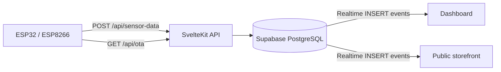

<div align="center">

<h1>IoT Mangga</h1>

<h3>Mango orchard monitoring and public storefront</h3>

<p>
  IoT Mangga is a web application that collects soil moisture, pH, and TDS readings
  from ESP32 and ESP8266 sensors installed in mango orchards. Orchard owners follow the readings
  on a live dashboard, and visitors browse a public storefront of harvested mangoes
  with soil quality indicators for each orchard.
</p>

<p>
  
  
  
  
  
  <br />
  
  
  
  
  
</p>

</div>

## Table of contents

- [Features](#features)
- [Tech stack](#tech-stack)
- [How it works](#how-it-works)
- [Getting started](#getting-started)
- [Supabase Realtime setup](#supabase-realtime-setup)
- [API reference](#api-reference)
- [Production build](#production-build)
- [Project structure](#project-structure)
- [Scaffolding command](#scaffolding-command)

## Features

### Realtime monitoring

- Live sensor dashboard powered by Supabase Realtime over WebSocket, with no polling.
- Historical charts for moisture, pH, and TDS per device.
- IoT device management with API keys that are shown once, at creation.
- Over-the-air (OTA) firmware updates for ESP32 and ESP8266.

### Orchard management

- Create and manage orchards (locations) at `/dashboard/kebun`.
- Assign IoT devices to orchards.
- View aggregated products for each orchard.

### Public storefront

The root route `/` is public and requires no login.

- Lists mango products grouped by orchard.
- Shows average moisture, pH, and TDS per orchard, updated live through Supabase Realtime.
- Marks soil quality with a green, yellow, or red indicator.
- Shows an empty state when no products are published.

### Product management

Manage products for each device at `/dashboard/devices/[id]`: add, edit, and delete.

| Field        | Notes                                |
| ------------ | ------------------------------------ |
| Name         | Required, maximum 200 characters     |
| Description  | Free text                            |
| Price        | Greater than or equal to 0           |
| Stock        | Greater than or equal to 0           |
| Unit         | Unit of sale                         |
| Harvest date | Date of harvest                      |
| Photo        | Image URL, must be a valid URL       |
| Published    | Toggle that controls public listing  |

## Tech stack

| Layer     | Technology                                                  |
| --------- | ----------------------------------------------------------- |
| Framework | [SvelteKit](https://svelte.dev/docs/kit)                    |
| Runtime   | [Bun](https://bun.sh)                                       |
| Database  | [Supabase](https://supabase.com) PostgreSQL                 |
| ORM       | [Prisma](https://www.prisma.io) with `@prisma/adapter-pg`   |
| Realtime  | Supabase Realtime (WebSocket)                               |
| Styling   | [Tailwind CSS](https://tailwindcss.com) v4                  |
| Hardware  | ESP32 and ESP8266 running C++ firmware                      |

## How it works



Devices send readings to the API with their API key. The API stores each reading in the `SensorData` table, and Supabase Realtime pushes new rows to the dashboard and the storefront.

## Getting started

### Prerequisites

- [Bun](https://bun.sh)
- A [Supabase](https://supabase.com) project

### Installation

```bash
git clone https://github.com/wildanzm/iotmangga.git
cd iotmangga
bun install
```

### Environment variables

Copy `.env.example` to `.env` and fill in the values:

```bash
cp .env.example .env
```

| Variable                   | Description                                              |
| -------------------------- | -------------------------------------------------------- |
| `PUBLIC_SUPABASE_URL`      | Supabase project URL, for example `https://xxx.supabase.co` |
| `PUBLIC_SUPABASE_ANON_KEY` | Supabase publishable (anon) key                          |
| `DATABASE_URL`             | Pooled PostgreSQL connection string (`?pgbouncer=true`)  |
| `DIRECT_URL`               | Direct PostgreSQL connection string, used by Prisma migrations |
| `CRON_SECRET`              | Secret used by scheduled (cron) tasks                    |

### Database setup

Create the initial migration and generate the Prisma client:

```bash
bunx prisma migrate dev --name init
bunx prisma generate
```

If the schema drifts from the migration history (for example after adding the orchard and product tables), choose one of these fixes.

Create a manual migration and mark it as applied:

```bash
# Print the SQL needed to match the schema
bunx prisma migrate diff --from-config-datasource --to-schema prisma/schema.prisma --script

# Save the SQL to prisma/migrations/<timestamp>_<name>/migration.sql, then run:
bunx prisma migrate resolve --applied <migration_name>
```

For local development only, push the schema directly without tracking history:

```bash
bunx prisma db push
```

### Run the development server

```bash
bun run dev
```

## Supabase Realtime setup

Live updates on the dashboard and storefront require Realtime on the `SensorData` table.

1. Open the Supabase Dashboard and go to Database, then Replication.
2. Enable replication for `public.SensorData`.
3. Enable `INSERT` events.

## API reference

Devices authenticate with the `x-api-key` header. Create a device in the dashboard and copy its key right away, because the dashboard does not show it again.

### Send sensor data

`POST /api/sensor-data`

| Header         | Value                      |
| -------------- | -------------------------- |
| `x-api-key`    | `iot_mangga_<api_key>`     |
| `Content-Type` | `application/json`         |

Request body:

```json
{
  "moisture": 65.2,
  "ph": 6.8,
  "tds": 320
}
```

Example:

```bash
curl -X POST https://<your-domain>/api/sensor-data \
  -H "Content-Type: application/json" \
  -H "x-api-key: iot_mangga_<api_key>" \
  -d '{"moisture": 65.2, "ph": 6.8, "tds": 320}'
```

### Check for firmware updates

`GET /api/ota`

| Header               | Example value       |
| -------------------- | ------------------- |
| `x-api-key`          | `<api_key>`         |
| `x-firmware-version` | `1.0.0`             |
| `x-mac-address`      | `AA:BB:CC:DD:EE:FF` |

## Production build

```bash
bun run build
bun run preview
```

## Project structure

```text
.
├── prisma/            # Prisma schema and migrations
├── src/               # SvelteKit application source
├── static/            # Static assets
├── .env.example       # Environment variable template
├── prisma.config.ts   # Prisma configuration
├── svelte.config.js   # SvelteKit configuration
├── vite.config.js     # Vite configuration
└── vercel.json        # Vercel configuration
```

## Scaffolding command

The project started from this SvelteKit template:

```bash
bun x sv@0.15.4 create --template minimal --no-types \
  --add prettier tailwindcss="plugins:typography,forms" \
  --install bun iotmangga
```
